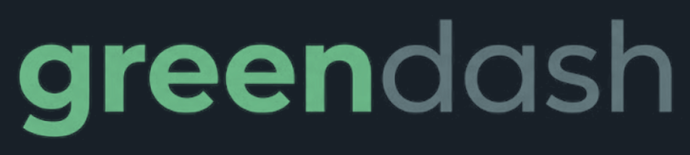

<div align="center">

&nbsp;

**VISUAL IDENTITY SYSTEM · VERSION 1.0**



### Brand guidelines for the trust-first green finance platform.

**CUSTOMER MOBILE APP · CUSTOMER WEB · BUSINESS DASHBOARD**

Megathon X: Singularity · Problem Statement 1 · Lloyds Green Customer Insights Platform

**OCTOBER 2026 · CONFIDENTIAL**

*Green, with receipts.*

</div>

<div style="page-break-after: always;"></div>

## CONTENTS

| # | Section | What it covers |
|---|---|---|
| 01 | Strategic Foundation | Brand story, mission, category, differentiator, audience |
| 02 | Naming Rationale | Why "greendash" |
| 03 | Identity Mark | The wordmark, its colours, lock-ups, app icon, usage rules |
| 04 | Colour System | Primary, secondary, surface, semantic palettes with HEX / RGB / CMYK |
| 05 | Typography | Typefaces, pairing logic, type scale |
| 06 | Voice & Tone | How greendash speaks, and what it never says |
| 07 | Copy in Practice | Voice applied to real product states |
| 08 | The Liquid Glass UI Language | Glass rules, elevation, corners, iconography, motion |
| 09 | Spacing, Taglines & Vocabulary | Grid system, taglines, words we own and avoid |
| 10 | Application Examples | Business dashboard widget and customer mobile card, specified in full |

<div style="page-break-after: always;"></div>

# 01 — STRATEGIC FOUNDATION

## What this brand actually stands for

> **We exist so that a green recommendation can be checked, not just believed.**
> Interest in greener choices rarely turns into action because nobody can tell what is relevant, what it would really save, or whether the claim is credible. greendash closes that trust gap with receipts.
>
> — CORE BRAND BELIEF

### Brand story

Customers want to switch to an EV, insulate a draughty home, fit solar panels or go paperless. Banks already have products that support each of those choices. Yet interest rarely becomes action.

The friction is not carbon measurement. It is **trust and actionability**. A customer cannot tell which option is relevant to *them*, what it would really save, or whether the bank's number is honest. A relationship team has green products and green-intent customers but no auditable bridge between the two. Today's carbon trackers stop at "here is your footprint". They present one confident number built on coarse averages, blur likelihood, eligibility and impact into one opaque "green score", and treat missing data as an error to hide.

greendash takes the opposite position. Every insight is a **Proof Card**: a recommendation that carries its own receipt. Three verdicts that never merge (Likelihood, Eligibility, Impact), dated evidence, a decomposed confidence, and a Claim-Check stamp proving that every sentence was verified against the numbers before anyone saw it. When the honest answer is "not enough information" or "not for you", greendash says so, because in green finance an AI that sounds confident but cannot show its working is a liability.

### Mission

To turn everyday banking data into green next steps that customers can trust and relationship teams can defend, with every number sourced, every refusal explained and every AI-written sentence checked.

### The core rule (appears on every surface)

> **ML predicts. Rules decide eligibility. The carbon engine calculates. The LLM only explains. Claim-Check verifies.**

### The brand at a glance

| | |
|---|---|
| **THE CATEGORY** | Trust-first green finance intelligence: a customer insight app and a portfolio dashboard on one evidence engine. Not a carbon tracker, not a chatbot, not a green score. |
| **THE SINGLE DIFFERENTIATOR** | **Proof before promise.** Three separate verdicts, visible uncertainty and machine-checked explanations. |
| **TARGET AUDIENCE** | **Customers** who are curious about greener choices but sceptical of green claims. **Relationship managers, portfolio analysts and auditors** who need a ranked, defensible pipeline. |
| **COMPETITOR GAP WE OWN** | Trackers stop at awareness and show one confident number. None show propensity, eligibility and impact as separate verdicts, admit uncertainty, make refusals visible, or check their own sentences. We do all four. |

### Five brand pillars

| Pillar | Meaning in the product |
|---|---|
| **Proven** | Every number has a source, a formula, a baseline and a date. |
| **Honest** | "I don't know" and "not for you" are designed states, never errors. |
| **Separate** | Likelihood, Eligibility and Impact never merge. Carbon, energy, paper and digital adoption never merge. |
| **Bills first** | The headline leads with money saved, then carbon. |
| **Human-reachable** | A path to a person is always visible. "Not a credit decision" is always visible. |

<div style="page-break-after: always;"></div>

# 02 — NAMING RATIONALE

## Why **greendash**

**green** is the destination: the lower-carbon choices customers want to make, and the product family (EV Finance, Green Home, Solar Finance, Paperless) the bank offers.

**dash** carries three meanings at once:

1. **The dashboard.** The business surface is a portfolio cockpit with drill-down, and the customer surface is a personal dashboard of next steps.
2. **The dash as a move.** To dash is to act quickly. The brand promise is turning interest into a clear next step in minutes, not months of fragmented advice.
3. **The dash as punctuation.** A dash joins two things that were separate. greendash is the bridge between a green-intent customer and a green product, and its signature interface device is a thin horizontal rule that links a claim to its evidence.

| Principle | Rule |
|---|---|
| **NAMING PRINCIPLE 1** | Plain words, instantly legible, no invented tech portmanteau and no dropped vowels. |
| **NAMING PRINCIPLE 2** | Works as noun and verb. "Open greendash." "It showed up on greendash." "Dash it across to your RM." |
| **NAMING PRINCIPLE 3** | Always written **lowercase, one word**: `greendash`. Never "GreenDash", "Green Dash" or "GREENDASH" in running copy. |
| **ALTERNATIVES REJECTED** | *GreenScore* (implies the merged score we refuse to ship), *EcoTrack* (tracker, not next step), *Carbonly* (suffix-brand noise). |

> **A note on feature names.** The working project documents use "GreenDash" and "Proof Card". Under the greendash brand, **Proof Card, Claim-Check, Confidence Ladder, Scenario Lab and Why not?** are retained as named features. "Proof" lives inside the product; **greendash** is the brand on the door.

<div style="page-break-after: always;"></div>

# 03 — IDENTITY MARK

## The logo


*Master artwork: `greendash-logo-master.png`. Variants (transparent, on-light, mono white, mono ink) ship alongside this document.*

### 3.1 Logo concept

greendash is a **wordmark-only identity**: the name, set in lowercase, split by weight and colour into two halves.

| Half | Treatment | What it says |
|---|---|---|
| **green** | **Bold**, soft Logo Green | The claim. The confident, forward-facing half: the choice the customer wants to make. |
| **dash** | **Regular**, muted Logo Slate | The working. The quieter instrument-panel half: the evidence, the dashboard, the receipt behind the claim. |

The heavy-to-light shift reads left to right as *conviction, then proof*. The soft green keeps the brand calm and trustworthy instead of loud and eco-campaigner, and the cool slate gives it the sober feel of a financial tool. There is no leaf, globe or icon, on purpose: the brand's job is to look credible, and the name carries the meaning.

### 3.2 Anatomy of the wordmark

| Property | Specification |
|---|---|
| **Case** | Lowercase, one word: `greendash` |
| **Letterforms** | Geometric sans with round bowls, a **single-storey "a"**, flat-cut stroke ends and an open-tail "g". The supplied artwork is the master: never retype it in a font. |
| **Weights** | `green` Bold (about 700). `dash` Regular (about 400). |
| **Tracking** | Tight and even; the gap between "n" and "d" matches the letter spacing, so the split is carried by colour and weight, not by a space. |
| **Proportions** | About 5.5 : 1 (width to height of the full artwork including ascender and descender). |
| **Ascender unit ("d")** | The height of the "d" ascender is the **clear-space unit** used throughout this section. |

### 3.3 Logo colours

Sampled from the supplied artwork. Confirm against the original source file before print production.

| Swatch | Name | HEX | RGB | CMYK | Role |
|---|---|---|---|---|---|
| ■ | **Logo Green** | `#6BB888` | 107, 184, 136 | 42, 0, 26, 28 | `green` on dark backgrounds |
| ■ | **Logo Slate** | `#62777C` | 98, 119, 124 | 21, 4, 0, 51 | `dash` on dark backgrounds |
| ■ | **Logo Navy** | `#182028` | 24, 32, 40 | 40, 20, 0, 84 | The background the master artwork was designed on |
| ■ | **Logo Green (on light)** | `#2E8B5A` | 46, 139, 90 | 67, 0, 35, 45 | `green` on light backgrounds |
| ■ | **Logo Slate (on light)** | `#4A6166` | 74, 97, 102 | 27, 5, 0, 60 | `dash` on light backgrounds |

**Contrast.** Logo Green on Logo Navy is ≈ 6.9:1, on Abyss ≈ 8.1:1. Logo Slate on Logo Navy is ≈ 3.5:1 and on Abyss ≈ 4.1:1, which passes the 3:1 bar for large graphical objects, so **the wordmark must never go below its minimum size on dark** (see 3.7). On light, Logo Green (on light) is ≈ 3.9:1 on Mist and ≈ 4.2:1 on white, and Logo Slate (on light) is ≈ 6.1:1 on Mist.

**Relationship to the UI palette.** The logo colours are brand colours for the wordmark and large brand moments only. In the interface, the action green is **Verdant** (`#19C37D`, section 04), a more saturated sibling that stays legible at small sizes and on glass. Do not use Verdant inside the logo, and do not use Logo Green for buttons or chart series.

### 3.4 Variants

| Variant | Background | Colours | File |
|---|---|---|---|
| **ON DARK** (master) | Logo Navy `#182028`, Abyss `#06110D`, Night Moss `#0C1D16`, Deep Glass | Logo Green + Logo Slate | `greendash-logo-dark-transparent.png`, `greendash-logo-on-navy.png` |
| **ON LIGHT** | Mist `#F1F8F4`, Pure `#FFFFFF`, Fog `#E3EFE9` | Logo Green (on light) + Logo Slate (on light) | `greendash-logo-on-light.png` |
| **MONO WHITE** | Photography with a 60% Abyss scrim, Verdant fills, one-colour print | Solid `#FFFFFF`, both halves | `greendash-logo-mono-white.png` |
| **MONO INK** | Fax, stamps, embossing, one-colour print on light stock | Solid Ink `#0B1F18`, both halves | `greendash-logo-mono-ink.png` |

### 3.5 Lock-ups and the Liquid Glass treatment

**Glass lives around the logo, never on it.** The letters are always flat, solid colour. The Liquid Glass character comes from the surface the logo sits on.

| Context | Treatment |
|---|---|
| **Dashboard top bar / side navigation** | Wordmark on a **G3 floating glass** bar (40px blur, 20% white fill, 1px gradient edge). Wordmark height 24px. Use the ON DARK variant over dark glass, ON LIGHT over frosted-white glass. |
| **Splash / launch screen** | Wordmark centred on the ambient aurora backdrop (Abyss base, Canopy and Aqua orbs). Fades and rises over 400ms with emphasized-decelerate easing. No other animation. |
| **Marketing and documents** | Wordmark on flat Logo Navy, Mist or White. Glass panels may sit nearby but never overlap the logo. |
| **Co-branding** | Place the Lloyds mark and greendash side by side, separated by a hairline at 20% opacity and equal clear space. Do not merge the two. |

### 3.6 App icon and avatar (derived asset)

The wordmark is too wide for an app icon, favicon or avatar, so use a **monogram**: the lowercase **"g"** lifted from the wordmark.

| Property | Specification |
|---|---|
| **Letter** | The "g" cropped from the master artwork, in Logo Green `#6BB888`, optically centred, occupying about 56% of the tile height |
| **Tile** | Squircle, corner radius 22.5% of width, base Logo Navy `#182028` with a subtle Deep Forest `#0A3B2C` gradient toward the bottom-right |
| **Glass** | 1px inner edge at `rgba(255,255,255,0.32)` fading to 8%, a soft top-left specular highlight, and a faint Mint Glow caustic under the letter at 25% opacity. Letter stays flat. |
| **Minimum** | 16px (favicon). Below 32px drop the glass details: flat Logo Green "g" on flat Logo Navy. |

This monogram is a proposed derived asset. Build it as vector geometry from the supplied artwork.

**Optional AI prompt for the icon tile only** (generate the glass tile empty, then place the real "g" on top in Figma, because generators distort letterforms):

```text
Empty app icon tile, iOS squircle shape, dark navy-to-deep-forest-green gradient (#182028 to #0A3B2C), frosted Liquid Glass material with a thin bright inner edge on the top-left fading to nothing at the bottom-right, a soft specular highlight, a very faint mint glow in the lower centre, subtle depth and soft diffused shadow, perfectly centered and symmetrical, front view, no text, no letters, no symbols, near-black background, premium minimal visionOS style --ar 1:1 --style raw --stylize 100 --v 6.1 --no text, letters, icons, objects, noise
```

### 3.7 Logo usage

#### DO

| Rule | Specification |
|---|---|
| **Clear space** | At least **1 d-height** (the "d" ascender height) on all four sides. For the monogram tile, clear space is ½ the tile width. |
| **Minimum size** | Wordmark: **96px / 25mm** wide on dark, **80px / 22mm** on light. Below that, switch to the monogram. |
| **Placement** | Top-left on web and dashboard, centred on mobile splash. |
| **Backgrounds** | Logo Navy, Abyss, Night Moss, Mist, White. On photography, use MONO WHITE over a 60% Abyss scrim. |
| **Always use the supplied files** | Do not retype, trace or redraw the wordmark. |

#### DON'T

| Rule | Why |
|---|---|
| Don't stretch, squash, skew, rotate or outline the wordmark. | Proportions are part of the identity. |
| Don't swap the two halves' colours or weights, or make the whole word one weight. | The green/slate split is the idea. |
| Don't use the dark-background colours on a light background, or the light-background colours on dark. | Contrast drops below the accessible floor. |
| Don't recolour with off-palette or UI colours (no Verdant, Amber, Aqua or Iris in the logo). | Colour carries meaning. |
| Don't place it on busy imagery, saturated red or orange, or any background where either half drops below 3:1. | Legibility and trust. |
| Don't apply glass, blur, bevels, gradients, glows or drop shadows to the letters. | The logo is flat; glass belongs to the surface. |
| Don't add a leaf, globe, tree, sprout or other eco icon next to or inside the wordmark. | Eco clichés are exactly what we are not. |
| Don't write the name as "GreenDash", "Green Dash" or "GREENDASH" in copy. | Naming rule 3. |
| Don't animate the logo beyond a single 400ms fade-and-rise. | Motion is a precise tool, not a toy. |

<div style="page-break-after: always;"></div>

# 04 — COLOUR SYSTEM

## One green. Every other colour earns its place.

Each colour is assigned a **semantic role**. They are not interchangeable. Using green for decoration, amber for success, or mixing chart colours across metric families breaks the system's logic, and in a product about trust, a logic break is a credibility break.

> **Contrast rule.** Verdant `#19C37D` is bright. **Never put white text on Verdant.** Use Abyss `#06110D` on Verdant fills (contrast ≈ 8.4:1). For green text on light surfaces use **Canopy** `#0F7A55`, not Verdant. All text meets WCAG 2.2 AA (4.5:1 body, 3:1 large). Never rely on colour alone: every status carries an icon and a word.

### 4.1 Primary colours: the green family

| Swatch | Name | HEX | RGB | CMYK | Role |
|---|---|---|---|---|---|
| ■ | **Verdant** (signature) | `#19C37D` | 25, 195, 125 | 87, 0, 36, 24 | Primary CTAs, RECOMMEND status, active states, key chart series. The brand's one loud colour. |
| ■ | **Canopy** | `#0F7A55` | 15, 122, 85 | 88, 0, 30, 52 | Green text and icons on light surfaces, pressed CTA state. |
| ■ | **Deep Forest** | `#0A3B2C` | 10, 59, 44 | 83, 0, 25, 77 | Brand backgrounds, tile base, dark-mode container tint, print primary. |
| ■ | **Mint Glow** | `#7BE5B5` | 123, 229, 181 | 46, 0, 21, 10 | Glass highlights, focus rings on dark, soft emphasis. |
| ■ | **Dew** | `#DDF8EA` | 221, 248, 234 | 11, 0, 6, 3 | Tinted fills on light mode, selected rows, success wash. |

**VERDANT: USAGE RULE.** Reserved for *action, verified positive state, and the primary data series*. If it is clickable, verified or the headline number, it can be Verdant. It is not for backgrounds, decorative shapes, or illustration fills. It is earned.

### 4.2 Secondary / accent colours: the four metric families

The brief demands that **emissions, energy, paper and digital adoption are always reported separately**, and that digital adoption is never shown as a carbon reduction. Each family therefore owns one colour, so a glance at any chart tells you which family you are looking at. Colours are never reused across families.

| Swatch | Name | HEX | RGB | CMYK | Metric family |
|---|---|---|---|---|---|
| ■ | **Verdant** | `#19C37D` | 25, 195, 125 | 87, 0, 36, 24 | **CO₂e** (estimated or realised) |
| ■ | **Solar Amber** | `#F5B53D` | 245, 181, 61 | 0, 26, 75, 4 | **Energy** (kWh) |
| ■ | **Aqua Signal** | `#22B8CF` | 34, 184, 207 | 84, 11, 0, 19 | **Paper** (sheets avoided) |
| ■ | **Iris** | `#8B7CF6` | 139, 124, 246 | 43, 50, 0, 4 | **Digital adoption** |
| ■ | **Slate Sage** | `#8AA79A` | 138, 167, 154 | 17, 0, 8, 35 | Neutral series, baselines, "before" values, SOFT_SURFACE |

**Chart rules**

- **Estimated** = 55% opacity fill with a 1.5px dashed top edge and the label "Estimate". **Realised** = 100% opacity solid fill. Estimated and realised are **never stacked or netted**.
- Maximum five series per chart. Order: Verdant, Aqua, Amber, Iris, Slate.
- Gridlines are `rgba(255,255,255,0.08)` on dark and `rgba(11,31,24,0.08)` on light. Axis labels use Ink Soft or the 70% white tier.

### 4.3 Background and surface colours (the glass substrate)

Liquid glass only works when there is something worth blurring behind it. greendash therefore pairs every surface with an **ambient backdrop**: a deep base colour with 2–3 soft blurred "aurora" orbs of Deep Forest, Canopy and a touch of Aqua, drifting slowly. Glass panels sit on top.

#### Dark mode (default for the business dashboard)

| Token | Name | HEX | RGB | CMYK | Use |
|---|---|---|---|---|---|
| `--bg` | **Abyss** | `#06110D` | 6, 17, 13 | 65, 0, 24, 93 | App background |
| `--surface-1` | **Night Moss** | `#0C1D16` | 12, 29, 22 | 59, 0, 24, 89 | Page sections, side nav fallback |
| `--surface-2` | **Deep Glass** | `#122A21` | 18, 42, 33 | 57, 0, 21, 84 | Opaque fallback for glass cards |
| `--glass-fill` | White glass | `rgba(255,255,255,0.08)` | n/a | n/a | Card fill over backdrop |
| `--glass-fill-strong` | White glass strong | `rgba(255,255,255,0.14)` | n/a | n/a | Raised/hovered glass, modals |
| `--glass-border` | Glass edge | `rgba(255,255,255,0.16)` | n/a | n/a | 1px border |
| `--text` | White | `#FFFFFF` at 94% | 255, 255, 255 | 0, 0, 0, 0 | Primary text |
| `--text-2` | White 68% | `rgba(255,255,255,0.68)` | n/a | n/a | Secondary text |
| `--text-3` | White 46% | `rgba(255,255,255,0.46)` | n/a | n/a | Tertiary, placeholders |

#### Light mode (default for the customer apps)

| Token | Name | HEX | RGB | CMYK | Use |
|---|---|---|---|---|---|
| `--bg` | **Mist** | `#F1F8F4` | 241, 248, 244 | 3, 0, 2, 3 | App background |
| `--surface-1` | **Pure** | `#FFFFFF` | 255, 255, 255 | 0, 0, 0, 0 | Opaque cards, sheets |
| `--surface-2` | **Fog** | `#E3EFE9` | 227, 239, 233 | 5, 0, 3, 6 | Inset wells, table zebra, fallback for glass |
| `--glass-fill` | Frosted white | `rgba(255,255,255,0.62)` | n/a | n/a | Card fill over backdrop |
| `--glass-fill-strong` | Frosted white strong | `rgba(255,255,255,0.80)` | n/a | n/a | Raised/hovered glass, modals |
| `--glass-border` | Glass edge | `rgba(255,255,255,0.90)` | n/a | n/a | 1px border (with a faint dark outer ring `rgba(11,31,24,0.06)`) |
| `--text` | **Ink** | `#0B1F18` | 11, 31, 24 | 65, 0, 23, 88 | Primary text (≈ 16:1 on Mist) |
| `--text-2` | **Ink Soft** | `#4A6358` | 74, 99, 88 | 25, 0, 11, 61 | Secondary text (≈ 6:1 on Mist) |

### 4.4 Semantic colours

| Swatch | State | HEX | RGB | CMYK | Used for |
|---|---|---|---|---|---|
| ■ | **Success** | `#22A06B` | 34, 160, 107 | 79, 0, 33, 37 | Claim-Check PASS, eligibility passed, saved, verified |
| ■ | **Warning** | `#F59E0B` | 245, 158, 11 | 0, 36, 96, 4 | Stale data, needs verification, low confidence |
| ■ | **Error** | `#E5484D` | 229, 72, 77 | 0, 69, 66, 10 | Failed claim (blocked), system failure, destructive actions |
| ■ | **Info** | `#4C8DFF` | 76, 141, 255 | 70, 45, 0, 0 | Notes, method links, mixed-signal REVIEW state |

**Semantic colours are never used as chart series colours.** Error red is never used because a recommendation is "no". A refusal is a designed state, not a failure.

### 4.5 The five card statuses

Every opportunity card is in exactly one status. Status controls prominence and wording; a low score never hides a pathway.

| Status | Colour | Icon | Badge text | Treatment |
|---|---|---|---|---|
| **RECOMMEND** | Verdant | check-circle | "Worth exploring" | Full Proof Card, glass-strong, Verdant 2px top accent |
| **SOFT_SURFACE** | Slate Sage | lightbulb | "Good to know" | Lower prominence, educational copy, flat glass |
| **ABSTAIN** | Warning amber | help-circle | "Need one thing" | Confidence Ladder step shown, impact figure hidden |
| **REVIEW** | Info blue | git-compare | "Mixed signals" | One confirming question, impact figure hidden |
| **RULED_OUT** | Slate Sage, dimmed | shield-check | "Not for you, and here's why" | "Why not?" panel naming the rule; no action button |

### 4.6 The three verdict badges

Likelihood, Eligibility and Impact quality are **always three separate components, never merged, never summed into a score**. Each uses its own glyph, so they are distinguishable without colour.

| Badge | Glyph | Values and colour |
|---|---|---|
| **Likelihood** (ML) | target | High (Verdant) · Medium (Amber) · Low (Slate Sage) |
| **Eligibility** (rules) | clipboard-check | Passed (Success) · Needs verification (Warning) · Not eligible (Slate Sage) |
| **Impact quality** (carbon engine) | gauge | High · Medium · Low, as a three-step meter in Aqua Signal |

> The Likelihood badge reads "High / Medium / Low", never a percent of "worthiness". Footnote on every Proof Card: *Likelihood is not creditworthiness.*

<div style="page-break-after: always;"></div>

# 05 — TYPOGRAPHY

## Type is the instrument panel

### 5.1 Typeface system

| Role | Typeface | Why |
|---|---|---|
| **DISPLAY & HEADINGS** | **Plus Jakarta Sans** (700–800) | Geometric-humanist, confident and friendly. Gives KPIs and headlines a premium, modern fintech voice without feeling cold. |
| **BODY & DATA UI** | **Inter** (400–600) with `font-feature-settings: "tnum" 1, "cv11" 1` | Engineered for screens, legible at 12px, excellent tabular figures so columns of numbers align in dense tables. |
| **UTILITY / SYSTEM** | **JetBrains Mono** (500) | Isolates system information (reason codes, timestamps, rule IDs, factor vintages) from prose. If it is machine-generated, it is mono. |

**Fallback stacks**

```css
--font-display: "Plus Jakarta Sans", "SF Pro Display", system-ui, sans-serif;
--font-body:    "Inter", "SF Pro Text", "Roboto", system-ui, sans-serif;
--font-mono:    "JetBrains Mono", "SF Mono", "Roboto Mono", ui-monospace, monospace;
```

**Pairing rationale.** Plus Jakarta Sans carries the brand's warmth and confidence at headline size. Inter disappears into the data so numbers can do the talking. JetBrains Mono makes every receipt detail (`HIGH_FUEL_SPEND`, `GP01-R1`, `DESNZ 2025 · row 14`) visibly *machine-sourced*, which is the brand's point: prose is explained, system fields are verified.

### 5.2 Type scale (desktop / dashboard)

| Style | Typeface | Weight | Size / line-height | Tracking | Use |
|---|---|---|---|---|---|
| **Display** | Plus Jakarta Sans | 800 | 56 / 64 px | −0.03em | Marketing hero, empty states |
| **H1** | Plus Jakarta Sans | 700 | 40 / 48 px | −0.02em | Page titles |
| **H2** | Plus Jakarta Sans | 700 | 28 / 36 px | −0.01em | Section headings, widget titles |
| **H3** | Plus Jakarta Sans | 600 | 20 / 28 px | 0 | Card titles, panel headings |
| **Subtitle** | Inter | 500 | 16 / 24 px | 0 | Card sub-headers, intro lines |
| **Body L** | Inter | 400 | 16 / 24 px | 0 | Insight text, customer prose |
| **Body** | Inter | 400 | 14 / 20 px | 0 | Default UI text, table cells |
| **KPI XL** | Plus Jakarta Sans | 800, tnum | 44 / 48 px | −0.02em | Headline metric tiles |
| **Data** | Inter | 600, tnum | 14 / 20 px | 0 | Table numerics, chart labels |
| **Label** | Inter | 600 | 12 / 16 px | +0.02em | Buttons, chips, form labels |
| **Tag (system)** | JetBrains Mono | 500 | 11 / 16 px | +0.12em, UPPERCASE | Reason codes, timestamps, rule IDs, "ESTIMATE" tags |

### 5.3 Type scale (mobile)

| Style | Size / line-height | Weight |
|---|---|---|
| Display | 36 / 44 | 800 |
| H1 | 28 / 36 | 700 |
| H2 | 22 / 28 | 700 |
| H3 | 18 / 24 | 600 |
| Body L | 16 / 24 | 400 |
| Body | 14 / 20 | 400 |
| KPI XL | 36 / 40 | 800 |
| Label | 12 / 16 | 600 |
| Tag | 11 / 16 | 500 |

**Rules.** Minimum 12px anywhere, 16px for form inputs on mobile (prevents iOS zoom). Support dynamic type to 200%. Numbers in tables and KPIs always use tabular figures. Never set body copy in Plus Jakarta Sans, never set data in a display weight below 600, and never use all-caps outside the mono Tag style.

<div style="page-break-after: always;"></div>

# 06 — VOICE & TONE

## How this brand speaks

greendash speaks like a **sharp, honest financial analyst who happens to care about the planet**: calm, specific and willing to say "I don't know". It is not an environmental campaigner and it is not a hype-driven fintech. It shows its working, quantifies its uncertainty and never claims more than the data supports.

**Honest · Specific · Calm · Evidence-led · Plain-spoken · Bills-first · Humble about uncertainty · Respectful · Never salesy**

### What we say

| Principle | Example |
|---|---|
| **Specific, with a date.** | "Fuel spend: £142 a month on average over the last 12 months (data as of 30 Sep)." |
| **Bills first, carbon second.** | "You could be spending less to get around. Estimated carbon cut: 1,150 to 1,750 kg CO₂e a year." |
| **Ranges, with the working.** | "Estimate, not a guarantee. Based on 9,200 miles a year against a petrol baseline." |
| **Admits what it doesn't know.** | "Not enough information to estimate. Add your yearly mileage to sharpen this." |
| **Says no, plainly.** | "Not for you right now: you already have an electric vehicle and no replacement need on record." |
| **Offers a human.** | "Prefer to talk it through? Speak to a person." |

### What we never say

| Never | Because |
|---|---|
| **Green hype**: "Save the planet!" / "Be a climate hero!" / "Go net zero today!" | Greenwashing tone, and regulators read it that way |
| **Certainty words**: "guaranteed", "will save", "approved", "pre-approved", "you qualify" | Claim-Check blocks these. The brand never says them either. |
| **Blame and guilt**: "Your car is a big polluter." | Customers are not our problem to shame |
| **AI-speak**: "Our cutting-edge algorithms leverage machine learning to…" | We show evidence, not technology |
| **Infantilising warmth**: "Great job! 🌍🎉 You're amazing!" | Respect their intelligence |
| **Passive hedging**: "It seems like you might perhaps want to consider…" | Say what you know, say what you don't |
| **A single score**: "Your Green Score is 82!" | We refuse the merged score |

### Tonal registers

| Register | Where | Character |
|---|---|---|
| **Confident** | RECOMMEND cards, KPIs | Clear and direct, concrete numbers |
| **Careful** | Impact estimates, eligibility | Ranges, formulas, "estimate" always present |
| **Candid** | ABSTAIN, REVIEW, RULED_OUT | Plain, unbothered, one next step |
| **Considerate** | Vulnerability indicators, accessibility paper need | No finance prompts, a human first, Consumer Duty-aligned |
| **Professional** | Business dashboard | Dense, neutral, evidence-first |

<div style="page-break-after: always;"></div>

# 07 — COPY IN PRACTICE

## Voice applied

### Proof Card headline (RECOMMEND)

**greendash voice**
> Your fuel spend has run above your usual level for 4 months. An EV could be worth exploring.
> `WHY NOW` Your car finance ends in 90 days.

**Not this**
> 🚗⚡ Congratulations! You're a perfect match for our EV loan! Save the planet and your wallet today!

### Impact estimate

**greendash voice**
> Estimated cut: 1,150 to 1,750 kg CO₂e a year, central estimate 1,450. Compared with your current petrol car, over 12 months, using DESNZ factors. Estimate, not a guarantee.

**Not this**
> You'll save 1,450 kg of carbon every year!

### Missing data (ABSTAIN)

**greendash voice**
> Not enough information to estimate this one. Add your yearly mileage and we can give you a range. It takes about 20 seconds.

**Not this**
> Oops! Something went wrong calculating your impact. Please try again later.

### Mixed signals (REVIEW)

**greendash voice**
> We're seeing mixed signals: your vehicle record says electric, but you still spend on fuel. Is there a second car in the household?

**Not this**
> Error: conflicting data detected.

### Hard exclusion (RULED_OUT, "Why not?")

**greendash voice**
> Not for you right now. You already have an electric vehicle and no replacement need on record (rule GP01-R1). If that changes, we'll re-check.

**Not this**
> Sorry, you're not eligible. 😔

### Changed circumstances

**greendash voice**
> Your circumstances changed, so we've paused this suggestion. Fuel spend has dropped and you told us you sold your car.

### Claim-Check stamp

**greendash voice**
> ✓ Every statement above was checked against our calculation engine. Tap to see which data backs each sentence.

### Paperless (separate metrics, no carbon claim)

**greendash voice**
> You've gone digital for 9 of your last 12 statements. 36 sheets of paper avoided. Digital adoption is tracked separately from carbon.

**Not this**
> Going paperless saved 3 trees and the planet! 🌳

### Business dashboard (RM brief)

**greendash voice**
> Priya is a strong EV Finance candidate: Likelihood High, Eligibility needs verification (existing finance ends in 90 days), Impact quality Medium (mileage declared, not observed). Suggested action: call within 14 days. Not a credit decision.

### Always-on microcopy

| Element | Copy |
|---|---|
| **Credit disclaimer** | Not a credit decision. |
| **Likelihood footnote** | Likelihood is not creditworthiness. |
| **Estimate label** | Estimate, not a guarantee. |
| **Human path** | Talk to a person |
| **Synthetic banner** | Demo data. Every customer shown is synthetic. |
| **Feedback** | Not relevant · This is wrong · Remind me later |

<div style="page-break-after: always;"></div>

# 08 — THE LIQUID GLASS UI LANGUAGE

## Glass for depth. Material for structure. Never glass for glass's sake.

greendash fuses two systems on purpose. **Material Design 3** supplies the *structure*: clear type hierarchy, tonal surfaces, dynamic colour roles, responsive layout and accessible states. **Liquid Glass** supplies the *atmosphere*: translucency, blur, specular edges and soft light. Rule of thumb: **structure is opaque and tonal, atmosphere is translucent**. Navigation chrome, hero cards and floating layers get glass. Dense tables, forms and long-form evidence stay on solid surfaces, because data legibility always beats effect.

### 8.1 Glassmorphism guidelines

#### The four glass tiers

| Tier | Name | Backdrop blur | Fill (dark / light) | Border | Use |
|---|---|---|---|---|---|
| **G0** | Flat | none | `Deep Glass #122A21` / `Pure #FFFFFF` | 1px `rgba(255,255,255,0.06)` / `rgba(11,31,24,0.08)` | Tables, forms, dense evidence panels, anything with long text |
| **G1** | Soft glass | `blur(16px) saturate(140%)` | `rgba(255,255,255,0.08)` / `rgba(255,255,255,0.62)` | 1px `rgba(255,255,255,0.16)` / `rgba(255,255,255,0.90)` | Standard cards and widgets |
| **G2** | Raised glass | `blur(24px) saturate(160%)` | `rgba(255,255,255,0.14)` / `rgba(255,255,255,0.80)` | 1px `rgba(255,255,255,0.24)` / `#FFFFFF` | Proof Cards, hero KPI tiles, popovers |
| **G3** | Floating glass | `blur(40px) saturate(180%)` | `rgba(255,255,255,0.20)` / `rgba(255,255,255,0.88)` | 1px `rgba(255,255,255,0.32)` / `#FFFFFF` | Bottom sheets, modals, tab bar, top app bar over scrolling content |

#### The five ingredients of every glass surface

1. **Blur.** `backdrop-filter: blur(Npx) saturate(S%)` per the tier above. Saturation boost keeps the glass from looking grey.
2. **Tint.** The translucent fill. Never pure white at more than 20% in dark mode, and never below 55% in light mode, or text contrast collapses.
3. **Edge.** A **1px border** with a *directional gradient*: brightest at the top-left, fading to ~25% at the bottom-right, as if light grazes the top-left edge.
4. **Inner light.** `inset 0 1px 0 rgba(255,255,255,0.30)` (top specular) plus `inset 0 -1px 0 rgba(255,255,255,0.05)` (bottom bounce). Use a faint inner shadow `inset 0 0 24px rgba(255,255,255,0.04)` on G2 and above for a liquid, thickened look.
5. **Ambient shadow.** A soft diffused shadow *tinted green-black*, never neutral grey (see 8.2).

#### Reference CSS (dark mode, G2 card)

```css
.gd-glass-2 {
  background: linear-gradient(135deg, rgba(255,255,255,0.18), rgba(255,255,255,0.08));
  -webkit-backdrop-filter: blur(24px) saturate(160%);
          backdrop-filter: blur(24px) saturate(160%);
  border: 1px solid rgba(255,255,255,0.24);
  border-radius: 24px;
  box-shadow:
    inset 0 1px 0 rgba(255,255,255,0.30),
    inset 0 -1px 0 rgba(255,255,255,0.05),
    0 8px 32px rgba(0, 12, 8, 0.45);
}
@supports not ((backdrop-filter: blur(1px)) or (-webkit-backdrop-filter: blur(1px))) {
  .gd-glass-2 { background: #122A21; }   /* opaque fallback */
}
@media (prefers-reduced-transparency: reduce) {
  .gd-glass-2 { background: #122A21; backdrop-filter: none; }
}
```

#### The ambient backdrop

| Layer | Spec |
|---|---|
| **Base** | Abyss `#06110D` (dark) or Mist `#F1F8F4` (light) |
| **Orb 1** | Canopy `#0F7A55` at 40% (dark) / 22% (light), 520px circle, `blur(120px)`, top-left |
| **Orb 2** | Verdant `#19C37D` at 18% (dark) / 14% (light), 380px, `blur(120px)`, lower-right |
| **Orb 3** | Aqua Signal `#22B8CF` at 12% (dark) / 10% (light), 320px, `blur(120px)`, mid-right |
| **Grain** | 2% monochrome noise overlay to prevent banding |
| **Motion** | Orbs drift ≤ 24px over 40 seconds. Static when reduced motion is on. |

#### Hard glass rules

| Rule | Detail |
|---|---|
| **Max two glass layers deep.** | A G1 card may sit on the backdrop. A G3 sheet may sit over a G1 card. Never glass on glass on glass. |
| **No glass behind long text.** | Paragraphs, tables, the evidence list and Claim-Check details sit on G0 (solid) *inside* a glass container. |
| **Contrast beats effect.** | If text over glass drops below 4.5:1 at any scroll position, raise the fill opacity or add a 20% Abyss scrim. |
| **Fallbacks are mandatory.** | Provide opaque fallbacks for no `backdrop-filter`, battery saver, `prefers-reduced-transparency`, and low-power devices. The product must be fully usable and still on-brand without any blur. |
| **Performance.** | Maximum 6 simultaneous blurred layers on screen on web, 4 on mobile. Never animate `backdrop-filter` radius. |
| **Glass is for chrome and highlights.** | Verdicts and badges are solid, never translucent: a trust signal must not look see-through. |

### 8.2 Elevation and shadows

greendash uses **Material Design 3's five-level elevation scale for hierarchy**, and expresses each level with **soft diffused, green-tinted glass shadows** and a tonal tint rather than the stock grey drop shadow.

| Level | M3 role | Glass tier | Shadow (dark mode) | Shadow (light mode) | Use |
|---|---|---|---|---|---|
| **0** | Surface | G0 | none | none | Page, tables, forms |
| **1** | Elevated card | G1 | `0 2px 8px rgba(0,12,8,0.30)` | `0 2px 8px rgba(11,31,24,0.06)` | Standard widgets |
| **2** | Raised card | G2 | `0 8px 24px rgba(0,12,8,0.40)` | `0 8px 24px rgba(11,31,24,0.10)` | Proof Cards, KPI tiles, hover state of G1 |
| **3** | Menu / popover | G2+ | `0 12px 32px rgba(0,12,8,0.48)` | `0 12px 32px rgba(11,31,24,0.14)` | Dropdowns, tooltips, drill-down peek |
| **4** | Sheet / dialog | G3 | `0 20px 48px rgba(0,12,8,0.55)` | `0 20px 48px rgba(11,31,24,0.18)` | Bottom sheets, modals, scenario panel |
| **5** | Drag / floating | G3 | `0 28px 64px rgba(0,12,8,0.60)` | `0 28px 64px rgba(11,31,24,0.22)` | Dragging, FAB while pressed |

**Dynamic elevation.** On hover or press, a card rises one level over 150ms and its top-edge highlight brightens by 6%. On dark mode, higher elevation also **lightens the tonal tint** (M3 tonal elevation): level 2 adds a 5% Verdant overlay, level 4 adds 8%. **Verdict badges never float**: they stay at level 0 inside their card so they read as fixed facts.

**Focus ring.** 2px Mint Glow `#7BE5B5` (dark) or Canopy `#0F7A55` (light), 2px offset, always visible on keyboard focus.

### 8.3 Corner radii

| Component | Radius |
|---|---|
| **Dashboard widget / large card** | 28px |
| **Proof Card, mobile card** | 24px |
| **Modal, dialog** | 28px |
| **Bottom sheet (top corners)** | 32px |
| **Standard button, input, select** | 14px |
| **Primary CTA, chip, badge, tag** | Full pill (999px) |
| **Table container** | 20px (rows square) |
| **Tooltip, small popover** | 12px |
| **Chart bars** | Top corners 6px, bottom 2px |
| **App icon / mark tile** | 22.5% (continuous squircle) |
| **Nested elements** | Inner radius = outer radius − padding (never equal, never larger) |

All radii use **continuous (squircle) curves** where the platform allows (`corner-shape: squircle` on supporting browsers, native on iOS).

### 8.4 Iconography

| Property | Spec |
|---|---|
| **Style** | **Rounded outline.** Material Symbols Rounded (weight 400, optical size 24) or Lucide as the working library. |
| **Grid and stroke** | 24px grid, **1.75px stroke**, round caps and joins |
| **Sizes** | 16 (inline), 20 (controls), 24 (default), 32 (feature), 48 (empty state) |
| **Fill rule** | Outline everywhere. **Filled is allowed only for the selected tab / nav item** (an M3 convention) and for the RECOMMEND check. Never mix filled and outline at the same hierarchy level. |
| **Colour** | Ink / White 68% by default. Verdant (dark) or Canopy (light) when active. Never decorative colour. |
| **Container** | Feature icons sit in a 40px G1 glass circle with a 1px edge. |
| **Pathway glyphs** | EV Finance: car-front with plug. Green Home: house with leaf-cut roof. Solar Finance: sun over roof. Paperless: sheet with check. All share the 1.75px stroke. |
| **Never** | Globes, trees, earth, recycling arrows, leaf clip-art. The identity uses no icon at all; the wordmark carries the brand. |

### 8.5 Layout and responsiveness (M3 window classes)

| Class | Width | Columns | Margins | Navigation |
|---|---|---|---|---|
| **Compact** | < 600px | 4 | 16px | Floating glass bottom tab bar (5 tabs), top app bar |
| **Medium** | 600–839px | 8 | 24px | Navigation rail (glass), top app bar |
| **Expanded** | 840–1199px | 12 | 24px | Rail or collapsed drawer |
| **Large / Extra-large** | ≥ 1200px | 12 | 32px | Permanent glass side navigation (264px), max content width 1280px |

### 8.6 Motion language

| Token | Duration | Use |
|---|---|---|
| **Micro** | 150ms | Hover, press, toggle, badge change |
| **UI transition** | 250ms | Sheet open/close, tab switch, accordion |
| **Page / screen** | 400ms | Route changes, drill-down level change, dashboard load |
| **Ambient** | 40s | Backdrop orb drift only |

| Easing | Curve | Use |
|---|---|---|
| **Emphasized decelerate** | `cubic-bezier(0.05, 0.7, 0.1, 1)` | Elements entering |
| **Emphasized accelerate** | `cubic-bezier(0.3, 0, 0.8, 0.15)` | Elements leaving |
| **Standard** | `cubic-bezier(0.2, 0, 0, 1)` | State changes |

- No bounce, spring or elastic motion. Never linear easing. Motion is a precise tool, not a toy.
- **Drill-down** moves are a shared-axis transition: the selected row expands into the next level over 400ms with the glass edge brightening as it lands, so the user always sees *where* they came from.
- **The Claim-Check moment.** When a sentence passes verification, its underline resolves left to right in Verdant over 250ms, then a check appears. When a sentence is *blocked*, it dims, a 1px Error underline appears, and the safe template text fades in beneath. No shake, no flash.
- **Reduced motion** (`prefers-reduced-motion`): replace all movement with 150ms cross-fades and freeze the backdrop.

### 8.7 Emotional register

greendash does not have one mood. It shifts between five registers, each tied to a touchpoint.

| Register | Colour anchor | Touchpoint |
|---|---|---|
| **Authority** | Deep Forest / Abyss | Homepage, brand, governance tab |
| **Evidence** | Aqua Signal | Evidence panels, impact calculation, factor sources |
| **Momentum** | Verdant | RECOMMEND cards, funnel, progress |
| **Candour** | Warning amber / Info blue | ABSTAIN, REVIEW, Why not? |
| **Calm** | Mist / Dew | Customer light-mode surfaces, "You're all set" |

### 8.8 Accessibility floor

WCAG 2.2 AA minimum. Tap targets **44 × 44px**, 8px between targets. All status carried by icon + text + colour. Charts pair colour with pattern (dash style) and a data-table alternative. Focus always visible. Dynamic type to 200% without clipped content. Glass fallbacks per 8.1. Never use colour alone to separate "estimated" from "realised".

<div style="page-break-after: always;"></div>

# 09 — SPACING, TAGLINES & VOCABULARY

## The grid

| 4px | 8px | 12px | 16px | 24px | 32px | 48px | 64px | 80px |
|---|---|---|---|---|---|---|---|---|
| tight | icon gap | chip pad | card pad (mobile) | card pad (desktop) | section gap | block gap | page gap | hero gap |

**Base unit: 4px.** Every spacing value is a multiple of 4. This is a hard system, not a loose guideline. Component interiors use an **8px rhythm**.

| Context | Spec |
|---|---|
| **Max content width** | 1280px desktop |
| **Desktop grid** | 12 columns, **24px gutters**, 32px margins |
| **Tablet grid** | 8 columns, 16px gutters, 24px margins |
| **Mobile grid** | 4 columns, 16px gutters, 16px margins |
| **Card padding** | 24px desktop, 16px mobile (20px for Proof Cards) |
| **Widget gap** | 24px desktop, 16px mobile |
| **Vertical rhythm** | Section gap 48px, block gap 32px, related-item gap 12–16px |
| **Safe areas** | Respect device insets; the floating tab bar sits 12px above the bottom inset |

## The words we own

### Primary tagline

# "Green, with receipts."

Direct and memorable. Names the category (green finance) and the differentiator (proof) in four words, without mentioning AI. The receipt *is* the product.

### Supporting taglines

| Tagline | Use |
|---|---|
| "Your next green step, proven." | Customer app, onboarding |
| "Every number shows its working." | Dashboard, governance, pitch |
| "Know why. Know how sure." | Proof Card feature marketing |
| "Likelihood. Eligibility. Impact. Never blurred." | Business and regulator-facing |
| "We'll tell you when we don't know." | Honesty campaigns, trust page |

### Words we own

**Proof · Receipt · Evidence · Estimate · Verified · Checked · Next step · Why now · Why not · Range · Baseline · Working · Bills first · Separate · Plain**

### Words we avoid

"Guaranteed" · "Will save" · "Pre-approved" · "Approved" · "You qualify" · "Carbon neutral" · "Net zero hero" · "Save the planet" · "Eco-friendly" · "Green score" · "Eco-warrior" · "Supercharge" · "Revolutionary" · "Cutting-edge" · "Game-changing" · "Seamless" · "Leverage" · "Synergy" · and anything that sounds like a press release, a greenwash or a Series A pitch deck.

<div style="page-break-after: always;"></div>

# 10 — APPLICATION EXAMPLES

> All figures below are **illustrative synthetic demo data**, and the synthetic-data banner is always present in the prototype.

## 10.1 Business Dashboard widget: the Opportunity Quadrant

**Where it lives.** Level 2 of the portfolio drill-down (Portfolio → Opportunity → Customer → Evidence → Impact → Action), on the dark-mode Cockpit.

**Footprint.** Spans 8 of 12 columns on desktop, 28px radius, **G2 raised glass** (24px blur, 14% white fill, 1px gradient edge, level-2 shadow). 24px internal padding.

**Anatomy, top to bottom**

1. **Header row (40px).** Left: H3 "Opportunity quadrant" in White, with a Tag-style mono chip beside it reading `EV FINANCE`. Right: a segmented control (EV · Home · Solar · Paperless) in pill style, the active segment filled Verdant with Abyss text, plus a small `ESTIMATE` mono tag in Slate Sage, so the nature of the data is never ambiguous.
2. **Subtitle (Body, White 68%).** "Propensity × impact × confidence, 5,000 synthetic customers, data as of 30 Jun 2026."
3. **Plot area (G0 inset well, 20px radius, Deep Glass fill).** A scatter on a 2×2 grid: X-axis = Propensity (low to high), Y-axis = Estimated impact. Gridlines at 8% white. A faint centre cross divides the quadrants. Each dot is a customer cohort (not an individual): circle area encodes cohort size, **opacity encodes confidence** (high confidence 100%, low 40% with a dashed outline). Dots are Verdant for RECOMMEND, Slate Sage for SOFT_SURFACE, and amber-outlined for low-confidence cohorts. Estimated impact is plotted as a vertical range whisker, never a single point.
4. **Quadrant labels** (mono Tag, 11px, White 46%) sit in each corner of the plot, and each quadrant carries a one-line action in Label type:
   - Top-right: "RM call list"
   - Top-left: "Educate, no hard sell"
   - Bottom-right: "Digital nudge"
   - Low-confidence, high-impact zone: "Enrich data"
5. **Selected cohort callout (G3 floating glass, 12px radius, level-3 shadow).** Appears on hover/click: "Commuter homeowners · 412 customers · Propensity High · Eligibility 78% passed, 22% need verification · Impact quality Medium · Est. 1,150–1,750 kg CO₂e a year per customer." Reason codes follow in mono: `HIGH_FUEL_SPEND` `EXISTING_VEHICLE` `FINANCE_ENDING`. Primary action: **"Open call list"** (pill, Verdant fill, Abyss text). Beneath it a ghost link: "See evidence".
6. **Footer strip (G0, 48px).** Three separate metric chips, **never summed**: CO₂e in Verdant · Energy kWh in Amber · Digital adoption in Iris, each prefixed with `EST` or `REALISED` in mono. Far right, the Claim-Check counter: "✓ 1,284 sentences verified · 7 blocked" in Label type, Success and Error dots, with the Error dot never larger than the Success dot.

**States.** *Loading:* three shimmering G1 skeleton blocks, 400ms emphasized-decelerate fade-in. *Empty cohort (n < 10):* the cell greys, with "Hidden to protect privacy (fewer than 10 customers)". *Stale data:* amber `STALE` mono tag and a thin amber top edge.

**Behaviour.** Clicking a cohort performs the shared-axis drill-down: the callout expands over 400ms into the Customer list (Level 3), and the breadcrumb at the top updates (`Portfolio / EV Finance / Commuter homeowners`).

## 10.2 Customer Mobile App card: the EV Finance Proof Card

**Where it lives.** Pathways tab → EV Finance → full Proof Card, light mode, 390px wide (compact class).

**The surface.** The screen background is Mist `#F1F8F4` with two soft backdrop orbs: Verdant at 14% top-right, Aqua at 10% mid-left, both blurred 120px. The card is **G2 raised glass in light mode**: 80% white fill, `blur(24px) saturate(160%)`, a 1px white edge with a faint 6% Ink outer ring, a **24px** radius, level-2 shadow, 20px padding, 16px from the screen edges. A 2px Verdant accent runs along the card's top edge.

**Anatomy, top to bottom**

1. **Status row.** A pill badge, Dew fill with a Canopy check-circle icon and the text "Worth exploring" in Label type. At right, a mono `AS OF 30 SEP` tag in Ink Soft.
2. **Headline (H3, Plus Jakarta Sans 600, 18/24, Ink).** "Your fuel spend has run above your usual level for 4 months. An EV could be worth exploring."
3. **Why-now chip.** A small Aqua-tinted pill with a clock icon: "Why now: your car finance ends in 90 days."
4. **Impact block (inset well, Fog fill, 16px radius, 16px padding).** Small label "Estimated yearly impact" with the tag `ESTIMATE`. Below it a KPI in Plus Jakarta Sans 800 at 36px, Canopy: **1,150 to 1,750 kg CO₂e**, and under that in Body, Ink Soft: "About £620 a year less on fuel and servicing, central estimate." A chevron opens the **Impact calculation sheet** (G3 bottom sheet, 32px top radius) showing the formula in plain words, the baseline ("vs. your current petrol car"), the horizon (12 months) and the factor source in mono (`DESNZ 2025 · conversion factors`).
5. **Three verdict badges in a row (always separate, never merged).** Three equal chips, 44px tall, each with its own glyph:
   - 🎯 target glyph: **Likelihood: High** (Verdant outline, Dew fill)
   - clipboard-check glyph: **Eligibility: Needs verification** (amber outline, amber 12% fill)
   - gauge glyph: **Impact quality: Medium** (three-step Aqua meter, two steps lit)
6. **Confidence Ladder row.** One line with a ladder icon: "Add your yearly mileage to sharpen this estimate." followed by a ghost pill button "Add mileage".
7. **Evidence accordion ("Why you're seeing this").** Collapsed by default, 250ms expand. Rows each have a chip showing provenance: a person icon for *You told us* (declared) or a receipt icon for *From your transactions* (inferred). Example: "Fuel spend: £142 a month on average, last 12 months" with the mono tag `HIGH_FUEL_SPEND`.
8. **Claim-Check stamp.** A soft Success-tinted strip with a shield-check icon: "Every statement above was checked against our calculation engine." Tap opens the Claim-Check sheet, with each sentence mapped to its source field.
9. **Actions.** Primary: full-width **pill button "Explore EV options"**, Verdant fill, Abyss text, 56px high, level-1 shadow with a faint Verdant glow. Secondary below it: ghost pill "Start with a 2-minute suitability check". A text link, "Talk to a person", always visible.
10. **Footer microcopy (Tag, Ink Soft).** "Not a credit decision. Likelihood is not creditworthiness."
11. **Feedback row.** Three text buttons in Label type: Not relevant · This is wrong · Remind me later.

**Sibling states (same card shell, different status)**

| State | What changes |
|---|---|
| **ABSTAIN** | Amber badge "Need one thing". The impact block is replaced by a locked skeleton and the Confidence Ladder step becomes the primary action. No number is shown. |
| **REVIEW** | Info-blue badge "Mixed signals". Impact hidden. One yes/no confirming question as the primary action. |
| **RULED_OUT** | Slate Sage dimmed card, shield-check icon, "Not for you right now" with a **Why not?** panel naming the rule in plain words. No action button; a link reads "See what else fits". |
| **SOFT_SURFACE** | Flat G1 glass, no top accent, "Good to know" badge, an educational headline and a "Learn more" action. |

**Bottom navigation.** A floating G3 glass tab bar, 64px high, 28px radius, 12px above the safe area, five tabs (Home · Pathways · Progress · Help · Profile). The selected tab uses a filled icon in Canopy with a Dew pill indicator; others stay outline in Ink Soft.

<div style="page-break-after: always;"></div>

<div align="center">

&nbsp;

## green**dash**

**BRAND GUIDEBOOK V1.0**
**OCTOBER 2026 · CONFIDENTIAL**

*Green, with receipts.*

</div>
